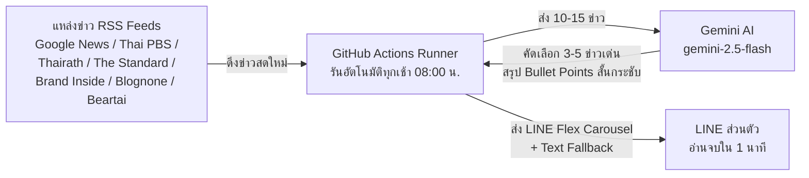

# 🌅 Daily Morning News Bot (Serverless)

> บอตสรุปข่าวเด่นยามเช้า ส่งตรงเข้า LINE ส่วนตัวทุก 08:00 น. แบบไม่ต้องเปิดคอมพิวเตอร์ทิ้งไว้ และไม่ต้องเช่าเซิร์ฟเวอร์ (ฟรี 100%)

---

## 📌 ภาพรวมระบบ (Architecture)

โปรเจกต์นี้ทำงานแบบ **Serverless 100%** โดยใช้บริการฟรีทั้งหมด:



1. **แหล่งดึงข่าว:** ดึงผ่าน RSS Feeds ของสำนักข่าวไทยชั้นนำโดยตรง (ไม่ต้องขูดเว็บ ไม่เสี่ยงโดนบล็อก)
2. **สมอง AI คัดกรองและสรุป:** ใช้ **Gemini API** คัดเลือกเฉพาะ **"3-5 ข่าวเด่นที่คนไทยควรรู้เช้านี้"** สรุปเป็น Bullet points สั้นกระชับ อ่านจบได้ภายใน 1 นาที พร้อมแนบลิงก์ไปยังข่าวต้นฉบับ
3. **ช่องทางรับข่าว:** ส่งตรงเข้าแชท **LINE** ส่วนตัวของคุณ ด้วย **LINE Flex Message Card** สวยงาม ทันสมัย มีป้ายหมวดหมู่ชัดเจน และปุ่มกดอ่านต่อ พร้อมระบบ Fallback เป็นข้อความตัวอักษรอัตโนมัติหาก Flex ส่งไม่ผ่าน
4. **รันอัตโนมัติทุกเช้า:** ใช้ **GitHub Actions (Cron Schedule)** ตื่นมารันโค้ดทุก 08:00 น. สรุปข่าว ส่งเข้า LINE แล้วปิดตัวเองทันที ไม่เปลืองทรัพยากร

---

## 🚀 จุดเด่นของโปรเจกต์

- ✅ **ฟรี 100%:** GitHub Actions (โควตารันฟรีเหลือเฟือ) + Gemini API Free Tier + LINE Messaging API Free Plan (ส่งฟรี 200 ข้อความ/เดือน)
- ✅ **Serverless แท้จริง:** ไม่ต้องเปิดคอมทิ้งไว้ ไม่ต้องตั้ง Home Server หรือเช่า Cloud VPS
- ✅ **LINE Flex Message สวยงาม:** การ์ดหมวดหมู่แยกสี (ธุรกิจ, การเงิน, ไอที, ทั่วไป) แสดง Bullet Points และปุ่มอ่านต่อที่ต้นฉบับ
- ✅ **ระบบป้องกันข้อผิดพลาด 2 ชั้น (Resilience):**
  - หาก Flex Message ผิดพลาด จะสลับไปส่งเป็น Structured Text Message ทันที ข่าวไม่ตกหล่นแน่นอน
  - หาก Gemini API ขัดข้อง ระบบจะคัดสรรข่าวเด่นจาก Raw Feed ส่งให้แทนทันที
- ✅ **ปรับแต่งง่ายผ่าน `config.yaml`:** เพิ่ม ลด หรือสลับเปิด/ปิด RSS Feed ได้อิสระโดยไม่ต้องแก้โค้ด

---

## 🛠️ สิ่งที่ต้องเตรียมก่อนเริ่ม

1. บัญชี [GitHub](https://github.com/) (ฟรี)
2. บัญชี Google สำหรับขอ [Google AI Studio (Gemini API)](https://aistudio.google.com/)
3. บัญชี LINE ทั่วไป และบัญชี [LINE Developers Console](https://developers.line.biz/)

---

## 📖 คู่มือการติดตั้งและตั้งค่าอย่างละเอียด (Step-by-Step)

### ขั้นตอนที่ 1: ขอ Gemini API Key (ฟรี)
1. เข้าไปที่ [Google AI Studio](https://aistudio.google.com/)
2. เข้าสู่ระบบด้วยบัญชี Google ของคุณ
3. คลิกปุ่ม **"Get API key"** จากเมนูด้านซ้ายบน
4. คลิก **"Create API key"** แล้วเลือกโปรเจกต์ (หรือ Create key in new project)
5. คัดลอกรหัส **API Key** เก็บไว้ (จะนำไปใช้เป็น `GEMINI_API_KEY`)

---

### ขั้นตอนที่ 2: สร้าง LINE Bot และขอ Token / User ID

#### 2.1 สร้าง Provider และ Messaging API Channel
1. เข้าสู่ระบบที่ [LINE Developers Console](https://developers.line.biz/console/) ด้วยบัญชี LINE ของคุณ
2. คลิกปุ่ม **"Create a new provider"** ตั้งชื่อ เช่น `MyNewsServices` แล้วกด Create
3. ในหน้าถัดไป ให้คลิกเลือก **"Create a Messaging API channel"**
4. กรอกข้อมูลที่จำเป็น:
   - **Channel name:** เช่น `Daily News Bot` (ชื่อที่บอตจะแสดงใน LINE)
   - **Channel description:** เช่น `บอตรายงานข่าวเช้าอัตโนมัติ`
   - **Category & Subcategory:** เลือกหมวดหมู่ทั่วไปตามต้องการ
   - **Email address:** กรอกอีเมลของคุณ
5. ติ๊กยอมรับข้อกำหนดแล้วกดปุ่ม **Create**

#### 2.2 ออก Channel Access Token (long-lived)
1. เมื่อสร้าง Channel สำเร็จ ให้คลิกเข้าไปที่ Channel นั้น
2. สลับไปที่แท็บ **"Messaging API"** (เมนูด้านบน)
3. เลื่อนลงมาด้านล่างสุด จะพบหัวข้อ **"Channel access token"**
4. คลิกปุ่ม **"Issue"**
5. คัดลอกรหัส Token ที่ปรากฏเก็บไว้ (จะนำไปใช้เป็น `LINE_CHANNEL_ACCESS_TOKEN`)

#### 2.3 หา User ID ของตัวคุณเอง
> ⚠️ **ข้อควรระวัง:** User ID ของ LINE ไม่ใช่ LINE ID ที่ใช้พิมพ์ค้นหาเพื่อน แต่เป็นรหัสเฉพาะทางระบบที่ขึ้นต้นด้วย `U` ตามด้วยตัวอักษรและตัวเลข 32 หลัก

1. **แอดเพื่อนบอตก่อน:** ในแท็บ **Messaging API** เลื่อนขึ้นไปด้านบน จะมี **QR code** ให้ใช้แอป LINE ในมือถือสแกนเพื่อเพิ่มบอตเป็นเพื่อน
2. **คัดลอก User ID:**
   - สลับไปที่แท็บ **"Basic settings"** (ข้างๆ Messaging API)
   - เลื่อนลงมาที่หัวข้อ **"Your user ID"** (ด้านล่างของหน้า)
   - จะเห็นรหัสรูปแบบ เช่น `U1234567890abcdef1234567890abcdef`
   - คัดลอกรหัสนี้เก็บไว้ (จะนำไปใช้เป็น `LINE_USER_ID`)

---

### ขั้นตอนที่ 3: นำโค้ดขึ้น GitHub และตั้งค่า Secrets

1. นำโค้ดทั้งหมดในโฟลเดอร์นี้ขึ้นไปไว้บน **GitHub Repository** ส่วนตัว (Private หรือ Public ก็ได้) ของคุณ
2. เข้าไปที่หน้า Repository ของคุณบน GitHub
3. ไปที่เมนู **Settings** (แถบด้านบนของ Repo)
4. ในแถบเมนูด้านซ้าย เลือก **Secrets and variables** -> **Actions**
5. คลิกปุ่ม **"New repository secret"** สีเขียว เพื่อเพิ่ม Secrets ทั้งหมด 3 ตัวดังนี้:

| Secret Name | คำอธิบาย | ตัวอย่างค่า |
|---|---|---|
| `GEMINI_API_KEY` | รหัส API Key ที่ได้จาก Google AI Studio | `AIzaSy...` |
| `LINE_CHANNEL_ACCESS_TOKEN` | Token ที่ได้จาก LINE Messaging API | `xxxxxx...` |
| `LINE_USER_ID` | User ID ของคุณที่ขึ้นต้นด้วย U | `U1234567890...` |

---

### ขั้นตอนที่ 4: ทดสอบการทำงาน (Manual Run)

คุณไม่จำเป็นต้องรอถึงเช้าวันถัดไปเพื่อดูผลลัพธ์ สามารถสั่งรันเพื่อทดสอบได้ทันที:

1. ไปที่แท็บ **Actions** บน GitHub Repository ของคุณ
2. ในแถบด้านซ้าย ให้คลิกเลือกเวิร์กโฟลว์ **"Daily Morning News Bot"**
3. ด้านขวาจะมีกล่องข้อความปรากฏขึ้น ให้คลิกปุ่ม **"Run workflow"** แล้วกดปุ่มสีเขียว **Run workflow**
4. รอประมาณ 30-60 วินาที เมื่อทำงานเสร็จ จะมีติ๊กถูกสีเขียว ✅
5. เปิดมือถือ เช็กแชท LINE ของคุณ จะได้รับสรุปข่าวเด่นเช้าวันนี้ทันที!
6. คลิกเข้าไปดูรายงานในหน้ารันของ GitHub Actions จะมีหัวข้อ **Daily News Summary** แสดงรายการข่าวและรายละเอียดทั้งหมดให้ตรวจสอบย้อนหลังได้

---

### ขั้นตอนที่ 5: การทำงานอัตโนมัติทุกเช้า (Cron Schedule)

ไฟล์ `.github/workflows/daily_news.yml` ได้ตั้งเวลาทำงานอัตโนมัติไว้แล้ว:
```yaml
on:
  schedule:
    # 08:00 น. เวลาประเทศไทย (UTC+7) = 01:00 UTC
    - cron: '0 1 * * *'
  workflow_dispatch:
```

> **หากต้องการเปลี่ยนเวลาส่งข่าว:**
> เวลาใน GitHub Actions จะอ้างอิงตามเวลาสากล **UTC** เสมอ (เวลาไทย = UTC + 7 ชั่วโมง)
> - อยากให้ส่งเวลา **07:00 น. (ไทย)** ➡️ ให้ตั้งเป็น `- cron: '0 0 * * *'` (00:00 UTC)
> - อยากให้ส่งเวลา **07:30 น. (ไทย)** ➡️ ให้ตั้งเป็น `- cron: '30 0 * * *'` (00:30 UTC)
> - อยากให้ส่งเวลา **08:30 น. (ไทย)** ➡️ ให้ตั้งเป็น `- cron: '30 1 * * *'` (01:30 UTC)

---

## ⚙️ การปรับแต่งแหล่งข่าว (`config.yaml`)

คุณสามารถแก้ไขไฟล์ `config.yaml` เพื่อเพิ่ม ลด หรือปิดการใช้งาน RSS Feed ของสำนักข่าวต่างๆ ได้อย่างอิสระ:

```yaml
settings:
  min_news_items: 3          # จำนวนข่าวขั้นต่ำที่ต้องการสรุป
  max_news_items: 5          # จำนวนข่าวสูงสุดที่ต้องการสรุป
  gemini_model: "gemini-2.5-flash" # โมเดล AI (gemini-2.5-flash หรือ gemini-1.5-flash)
  fetch_timeout_seconds: 15
  max_items_per_source: 5    # จำนวนข่าวย่อยต่อแหล่งข่าวที่จะดึงมาให้ AI พิจารณา

sources:
  - name: "Google News Thailand"
    category: "ข่าวเด่น"
    url: "https://news.google.com/rss?hl=th&gl=TH&ceid=TH:th"
    enabled: true

  - name: "Thai PBS"
    category: "ทั่วไป"
    url: "https://news.google.com/rss/search?q=site:thaipbs.or.th&hl=th&gl=TH&ceid=TH:th"
    enabled: true

  - name: "Thairath"
    category: "ทั่วไป"
    url: "https://www.thairath.co.th/rss/news"
    enabled: true

  - name: "Khaosod"
    category: "ทั่วไป"
    url: "https://www.khaosod.co.th/feed"
    enabled: true

  - name: "The Standard Wealth"
    category: "ธุรกิจ"
    url: "https://thestandard.co/category/wealth/feed/"
    enabled: true

  - name: "Brand Inside"
    category: "ธุรกิจ"
    url: "https://brandinside.asia/feed/"
    enabled: true

  - name: "Blognone"
    category: "ไอที"
    url: "https://www.blognone.com/atom.xml"
    enabled: true

  - name: "Beartai"
    category: "เทคโนโลยี"
    url: "https://www.beartai.com/feed"
    enabled: true
```

- หากต้องการปิดแหล่งข่าวใดชั่วคราว ให้เปลี่ยน `enabled: true` เป็น `enabled: false`
- หากต้องการเพิ่มสำนักข่าวใหม่ เพียงคัดลอกบล็อกด้านบนแล้วใส่ URL ของ RSS Feed สำนักข่าวนั้นๆ

---

## 💻 การทดสอบและพัฒนาในเครื่องคอมพิวเตอร์ (Local Development)

### 1. ติดตั้ง Dependencies
```bash
pip install -r requirements.txt
```

### 2. ทดสอบแบบ Dry Run (ไม่ต้องต่อ LINE)
โหมด Dry Run จะดึงข่าวจริง และเรียก AI สรุปข่าว จากนั้นจะพิมพ์ตัวอย่างข้อความและโครงสร้าง Flex Message ออกมาบนหน้าจอคอนโซลทันที เหมาะสำหรับทดสอบความถูกต้อง:

```bash
# บน Windows PowerShell
$env:GEMINI_API_KEY="your-gemini-api-key"
python -m src.main --dry-run

# บน macOS / Linux
GEMINI_API_KEY="your-gemini-api-key" python -m src.main --dry-run
```
*(หากไม่ใส่ GEMINI_API_KEY ระบบจะทดสอบการคัดเลือกข่าวแบบ Raw Feed Fallback ให้โดยอัตโนมัติ)*

### 3. รัน Unit Test Suite ทั้งหมด
โปรเจกต์นี้มาพร้อมชุดการทดสอบครอบคลุมทุกโมดูล:
```bash
python -m unittest discover -s tests -v
```

---

## 📁 โครงสร้างโปรเจกต์ (Project Structure)

```text
Daily_News/
├── .github/
│   └── workflows/
│       └── daily_news.yml       # เวิร์กโฟลว์ตั้งเวลารันอัตโนมัติทุกเช้า 08:00 น.
├── src/
│   ├── __init__.py
│   ├── config.py                # ตัวโหลดและตรวจสอบค่าตั้งค่า config.yaml และ Environment
│   ├── rss_fetcher.py           # ตัวดึงและแยกวิเคราะห์ RSS/Atom feeds พร้อมระบบคัดกรองข่าวซ้ำ
│   ├── gemini_summarizer.py     # ตัวเชื่อมต่อ Gemini API เพื่อคัดเลือกและสรุปข่าวเด่น 3-5 ข่าว
│   ├── line_notifier.py         # ตัวประกอบ LINE Flex Carousel Message และระบบส่งข้อความ Text สำรอง
│   └── main.py                  # ไพป์ไลน์หลักประสานงานการทำงานทั้งหมด
├── tests/
│   ├── __init__.py
│   ├── test_config.py           # ทดสอบการโหลดการตั้งค่าและ Environment Variables
│   ├── test_rss_fetcher.py      # ทดสอบการ Parse RSS 2.0 / Atom และการ Clean HTML
│   ├── test_gemini_summarizer.py# ทดสอบการสร้าง Prompt, การ Parse JSON และ Fallback Logic
│   ├── test_line_notifier.py    # ทดสอบ Flex Card Builder, Thai Date และ Fallback ส่ง Text
│   └── test_main.py             # ทดสอบ Flow การทำงานหลักแบบบูรณาการ
├── config.yaml                  # รายชื่อแหล่งข่าวและค่าตั้งค่าระบบ
├── requirements.txt             # ไลบรารีที่จำเป็น (requests, pyyaml)
├── .gitignore                   # รายการไฟล์ที่ไม่ต้องนำขึ้น Git
└── README.md                    # เอกสารคู่มือการใช้งานภาษาไทยฉบับสมบูรณ์
```

---

## 📄 License

MIT License - สามารถนำไปใช้งาน ปรับแต่ง และพัฒนาต่อได้อย่างอิสระ
